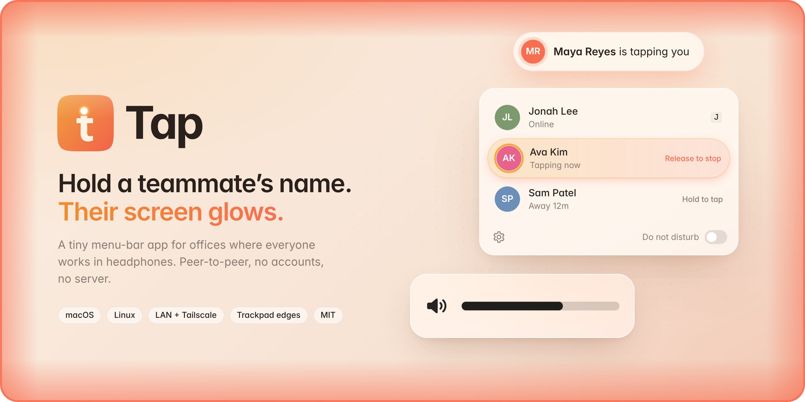
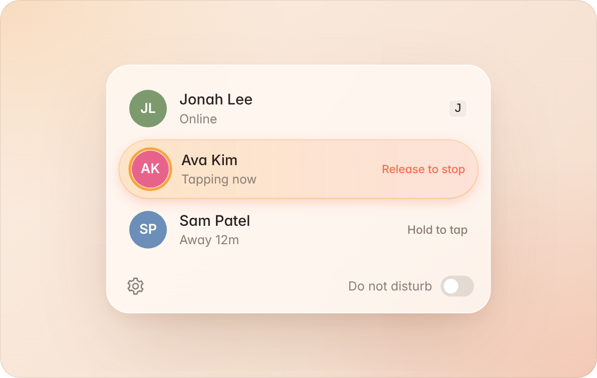
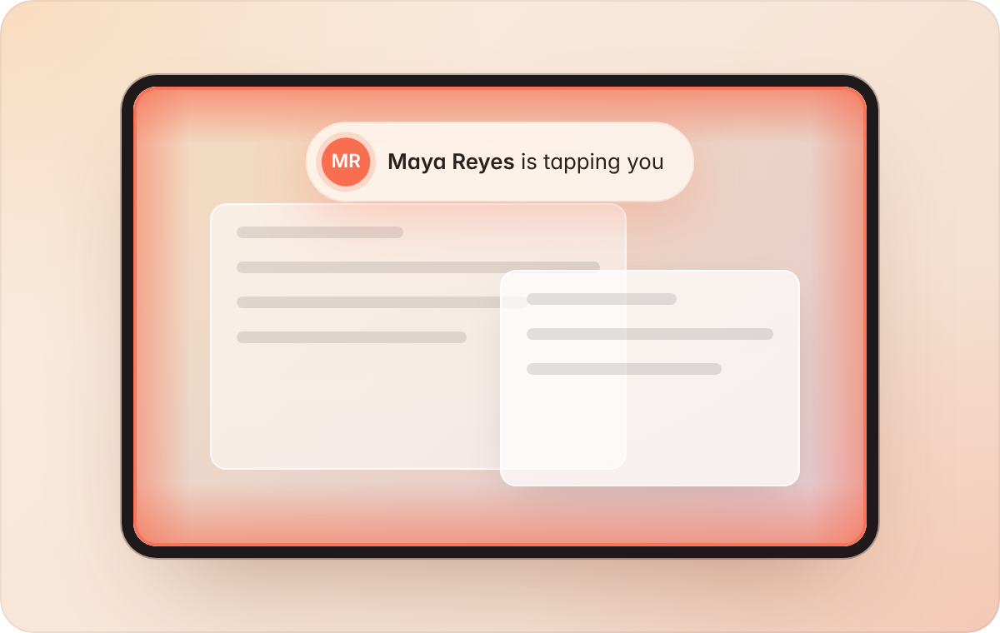
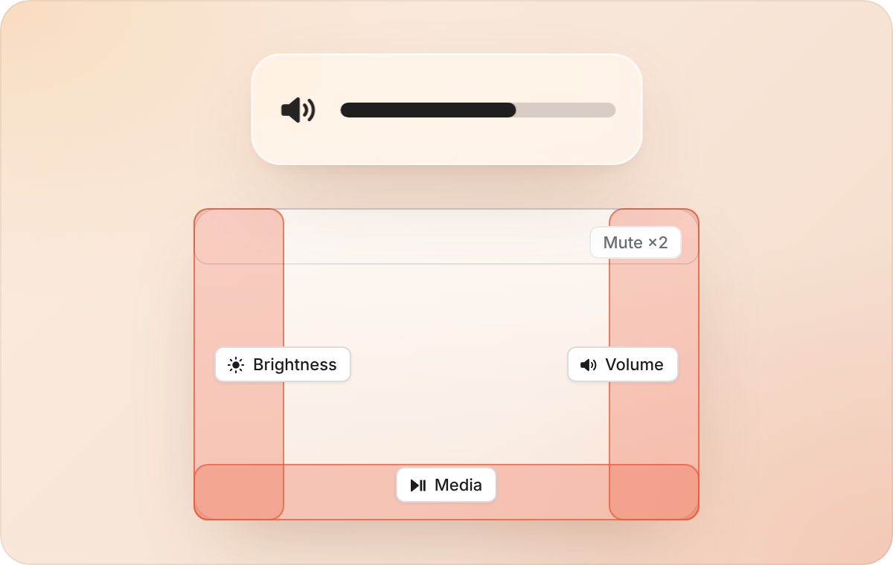
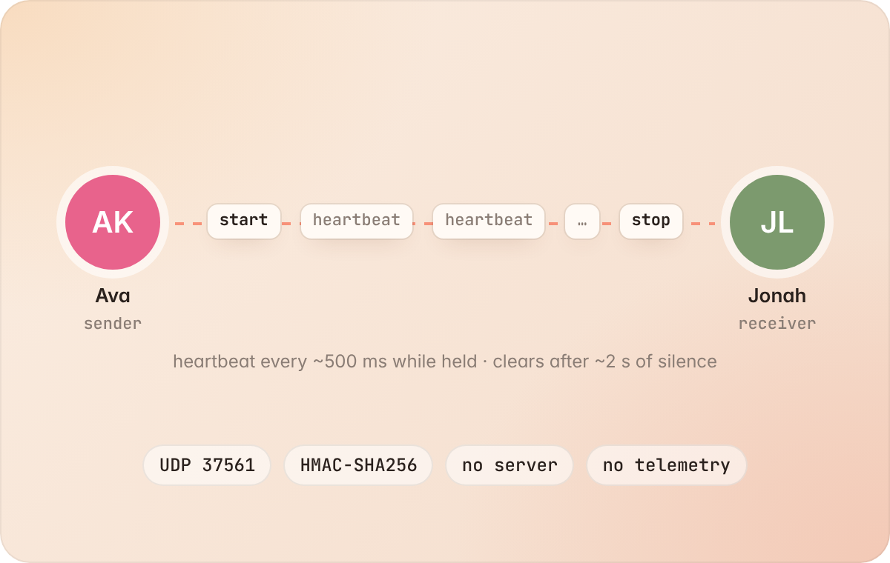

<div align="center">

<picture>
  <source media="(prefers-color-scheme: dark)" srcset="docs/readme/cover-dark.png">
  
</picture>

# Tap

**Press and hold a teammate in the menu bar to flash a click-through glow on their screens.**<br>
Built for offices where people work in headphones.

[](https://github.com/rhagerty32/tap/actions/workflows/ci.yml)
[](https://github.com/rhagerty32/tap/releases)
[](LICENSE)


[Install](#install) · [Set up a team](#set-up-a-team) · [How it works](#how-it-works) · [Build](#build-from-source) · [Contributing](#contributing)

</div>

---

<table>
<tr>
<td width="50%" valign="top">
<picture>
  <source media="(prefers-color-scheme: dark)" srcset="docs/readme/card-hold-dark.png">
  
</picture>

### Press and hold

Open the popover from the menu bar or tray and hold a teammate’s row. A ring fills, the row
lights up, and the tap runs for as long as you hold. Release to stop.
</td>
<td width="50%" valign="top">
<picture>
  <source media="(prefers-color-scheme: dark)" srcset="docs/readme/card-glow-dark.png">
  
</picture>

### Their screens glow

One transparent, always-on-top overlay per display. It’s click-through and never steals focus.
Pick from six glow styles: line, edge, soft, wash, bold and corners.
</td>
</tr>
<tr>
<td width="50%" valign="top">
<picture>
  <source media="(prefers-color-scheme: dark)" srcset="docs/readme/card-pad-dark.png">
  
</picture>

### Trackpad edges (Mac)

Slide an edge for volume, brightness or the current track, and a glass level panel follows
along. Rest a finger in a corner to tap the person you bound there. Set it up on the **Trackpad** tab.
</td>
<td width="50%" valign="top">
<picture>
  <source media="(prefers-color-scheme: dark)" srcset="docs/readme/card-p2p-dark.png">
  
</picture>

### Peer-to-peer and private

UDP on your LAN or Tailscale, signed with HMAC-SHA256 and protected against replays.
No central server, no accounts, no telemetry.
</td>
</tr>
</table>

### Also in the box

| | |
|---|---|
| **Keyboard** | Open the team list with a shortcut, then hold the letter or number you assigned a teammate (**Settings → Team**). Raycast script on macOS; on Linux, **Settings → App → Open team list** (default `Ctrl+Alt+Shift+T`). |
| **Discovery** | Same team key on the same tailnet, with mDNS on the local network and a typed host as a fallback. Leave the key blank to find anyone nearby. |
| **Tailscale only** | On by default once you set a team key. Ignores anyone outside `100.64.0.0/10`. With no key, your local network is included too. |
| **Do not disturb** | A switch right in the popover. |
| **Updates** | **Settings → App → Updates → Check for updates**, on release builds. |

## Install

### macOS

1. Download the `aarch64` (Apple Silicon) or `x64` (Intel) `.dmg` from [Releases](https://github.com/rhagerty32/tap/releases).
2. Open it and drag **Tap** to Applications.
3. macOS will say the app is damaged. That’s Gatekeeper; right-click → Open doesn’t help. Run:
   ```bash
   xattr -cr /Applications/Tap.app
   open /Applications/Tap.app
   ```
4. Allow **Local Network** access when prompted.

### Linux (Ubuntu / GNOME)

```bash
# AppImage
chmod +x Tap_*.AppImage
./Tap_*.AppImage

# Debian package
sudo dpkg -i tap_*_amd64.deb
sudo apt-get install -f
```

Tray dependencies, if needed: `libayatana-appindicator3-1`, `libwebkit2gtk-4.1-0`.

## Set up a team

1. Open Tap and set your **Name** (and optionally a photo) on the **Profile** tab.
2. Open **Settings → Team**. The **team key** is optional. Leave it blank to tap anyone on your local network or Tailscale, or choose the same key on every machine to keep a team private. Tap never generates one for you.
3. Log everyone into the same Tailscale tailnet (or be on the same local network). Teammates appear within a few seconds.
4. **Tailscale only** is on by default but only applies once a team key is set. Turn it off to also find people on the local network.

Settings tabs: **Profile**, **Glow**, **Team**, **Trackpad** (macOS only) and **App**.

## How it works

| Step | What happens |
|---|---|
| Hold | Sender sends UDP `start`, then a `heartbeat` about every 500 ms |
| Release | Sender sends `stop` and the glow fades out |
| Silence | If heartbeats stop for about 2 s, the receiver clears the overlay on its own |
| Port | `37561` by default. Allow it through your firewall between peers |

## Platform support

| Platform | Tray | Overlay |
|---|---|---|
| macOS (Apple Silicon + Intel) | Menu bar + popover | Per-display, click-through, all Spaces and full-screen |
| Linux X11 | Ayatana app indicator | Click-through works reliably |
| Linux Wayland (wlroots) | App indicator | Compositor-dependent stacking; wlr-layer-shell not wired in v1 |
| Ubuntu GNOME (Wayland) | Supported | Always-on-top fallback; may not stack above full-screen apps |

## Build from source

Prerequisites: [Tauri prerequisites](https://tauri.app/start/prerequisites/), Node 22+, Rust stable (pinned in `rust-toolchain.toml`).

```bash
npm ci
npm run tauri dev     # run
npm test              # cargo test
npm run tauri build   # bundles in src-tauri/target/release/bundle/
```

## Contributing

> **How changes land:** anyone can open a pull request against `main`. [@rhagerty32](https://github.com/rhagerty32)
> reviews every PR and is the only person who merges to `main`. Releases are cut from tags by the maintainer.

Read [CONTRIBUTING.md](CONTRIBUTING.md) and the [Code of Conduct](CODE_OF_CONDUCT.md) first.

## License

[MIT](LICENSE) © Ryan Hagerty
